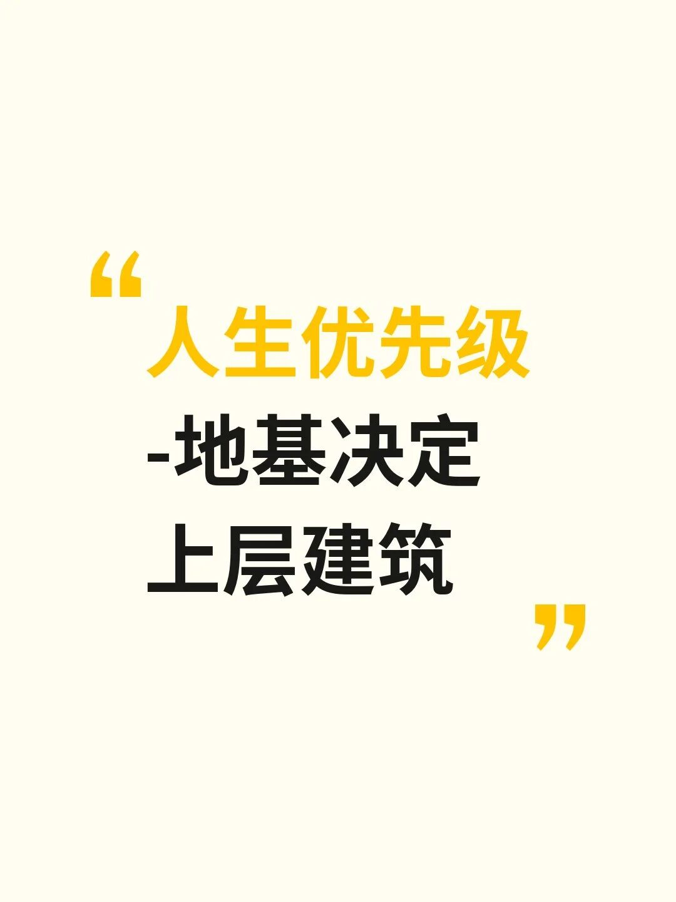

人生优先级-地基决定上层建筑

我以前也把搞钱排第一，事业第二，健康往后放。直到身边几个人让我改了看法。

有的事业刚起色就查出重病，有的挣到钱却天天焦虑失眠。还有个看着挺成功的人，跟他聊五分钟就能感觉到——整个人是空的。

所以我现在的排序变了：心态心情第一，休息睡眠第二，健康饮食第三，运动健身第四。挣钱和事业，根本不在前四里。

心态是操作系统，崩了啥都跑不起来。睡眠是底层重启，睡不好补再多营养品也是白搭。饮食决定身体原材料，运动只是放大器。你把状态搞好了，钱自然会来。

别想着一下全改。先挑一件，比如每天固定时间上床，坚持两周。或者每天出门走二十分钟。习惯是叠加的，慢慢你会发现生活完全不一样了。

